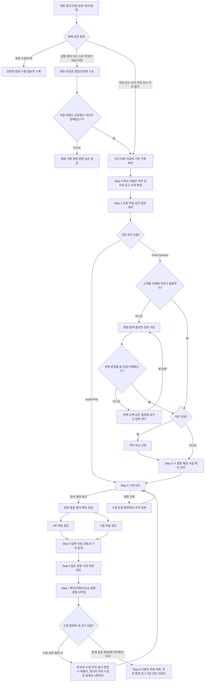

# JasoForge — 자기소개서 완결형 파이프라인 v5.2.0

공고와 지원자의 경험을 이해하고, 질문에 답하는 원고를 작성·평가·개선한 뒤 다음 지원에 쓸 기록을 남긴다. 사용자가 대화·링크·파일·본문으로 작업을 맡기면 에이전트가 필요한 자료와 도구를 연결해 끝까지 진행한다. 기록이 없으면 대화로 소재를 구체화한다. 사용자가 spec.json이나 평가 JSON을 직접 준비하는 것을 기본 사용법으로 요구하지 않는다.

독립 HR·기술 검토와 기계 검증은 이 과정의 핵심이다. 작성 점수, 규격 검사, 선택적 근거 대조를 분리한다. 작성 점수는 설명의 품질을 요약하며 실제 합격률은 아니다. 근거 없는 합격권 표시·만점 복원·업종별 자동 탈락 규칙을 복구하지 않는다.

## 실행 범위와 진입

현재 요청과 기존 문맥을 먼저 읽고 범위를 정한다. 명확한 요청을 다시 확인받지 않는다.

| 요청 | 실행할 과정 | 종료 지점 |
| --- | --- | --- |
| ‘파이프라인 태워줘’, ‘전체 작성·검증해줘’, 스킬에 지원 작업을 맡김 | 아래 Step 0~8. 기존 초안이면 Audit-First, 없으면 From-Scratch | 원고·독립 평가·수정·기록·최종 브리핑 또는 필요한 사실 대기 |
| ‘이 자소서 평가/진단해줘’ | 대상·문항 확인 → 선행 조사 → 린트 → HR/TECH 독립 평가 → 점수 원장 → 상세 리포트 | 원본은 보존하고 구체적 보완점까지. 수정은 요청된 경우 수행 |
| ‘이 공고로 1번 써줘’ | 선행 조사·경험 확보 → 해당 문항 작성·규격/내용 검토 → 버전·변경 기록 | 요청한 문항. 전체 채점은 사용자가 전체 파이프라인도 요청한 경우 |
| ‘경험부터 같이 정리해줘’, 지원 대상 없이 경험 정리를 요청 | 현재 대화·가진 자료 파악 → 경험 탐색·필요한 질문 → 경험 노트 | 경험 요약·남은 질문. 직무 탐색·지원서 작성은 요청 범위에 따라 연결 |
| ‘이 문장만 고쳐줘’, ‘윤문만’ | 확인된 사실과 문항에 맞춰 부분 수정 | 해당 범위. 조사·점수·전체 인터뷰로 확대하지 않음 |
| 공고/직무 분석만, 지원 상태 확인만 | 해당 조사·조회 | 분석 또는 상태 보고 |
| ‘지원서 칸 채워줘’, 브라우저로 지원서 입력을 맡김 | [입력 보조](references/application-entry.md) | 입력값 대조와 남은 칸 보고. 동의·최종 제출은 사용자 |
| 스킬 자체 검증·수정 | 지침·코드·기능 보존 검증 | 기존 지원서·Notion을 자동 수정하지 않음 |

### 입력과 저장 모드

- 대화·URL·Notion 페이지·PDF/TXT/MD/DOCX·붙여넣은 본문·회사/팀명 호출을 받는다. 파일명·길이만으로 초안이라 확정하지 말고 내용을 읽어 공고·초안·경험·가이드를 분류한다. `scripts/smart_router.py`는 첫 입력의 힌트이며 본문 읽기를 대신하지 않는다. 자료 없는 요청은 공고나 초안 제출을 요구하기보다 현재 문맥에서 작업을 시작한다.
- **Mode A — 로컬**: 사용자 설명과 제공된 자료를 사용하고 경험 기록을 쌓는다. Notion 계정 없이도 동일한 작성·평가·기록을 수행한다. 파일 평가의 기본은 로컬 저장이다.
- **Mode B — Notion 연동**: 사용자가 링크·기존 Notion 자료 활용·연동을 요청하면 관련 기존 자산부터 조회한다. `--sync-notion`/`--notion` 또는 현재 세션의 명시적 동기화 요청에 따라 해당 지원서·조사·평가·경험·변경 로그를 반영한다. 조회 요청만으로 쓰기를 시작하지 않는다.
- `--local`은 Notion을 사용하지 않는 로컬 작업이다. 필요한 공개 공고·회사 조사는 할 수 있다. `--offline`은 모든 네트워크 조회를 하지 않는다. `--quick`은 제공 자료로 빠르게 검토하되 생략한 조사·독립 평가를 완료했다고 보고하지 않는다.
- **기존 자산이 있으면 재사용**: 현재 대화와 제공·연결된 자료부터 읽는다. 해당 작업 공간·인덱스에 기존 기록이 있으면 재사용하고, 없다고 확인했으면 사용자 전체 디스크나 무관한 Notion을 계속 탐색하지 않는다. Notion은 [연동 계약](references/notion_schema.md)을 먼저 읽는다. 초안이 이미 있으면 다시 직무를 고르거나 처음부터 인터뷰하지 않는다. 신규 작성에 소재가 부족하거나 경험 정리를 요청하면 [대화 기반 경험 수집](references/experience-intake.md)을 따른다. 증빙 수집을 선행 필수조건으로 만들지 않는다.
- 모호한 팀명은 공고·공식 검색으로 채용 법인과 고객사/담당 서비스를 구별한다. 해결되지 않은 법인·직무만 한 번에 질문한다. 본문에 등장한 협업 팀을 지원 조직으로 오인하지 않는다.
- **작성 프로필**: 사용자가 반복 교정으로 정한 문체·구조·소재 선호가 있으면 작업 시작 때 읽고 작성과 기계 검사에 반영한다. 평가자에게는 넘기지 않는다. 찾는 위치와 적용 범위는 [작성 프로필](references/author-profile.md)을 따른다. 개인 선호를 이 스킬의 공개 규칙으로 바꾸지 않는다.

### 진행 원칙

- **마감 압박은 생략 사유가 아니다.** 남은 시간은 알리되 단계를 줄이자고 먼저 제안하지 않는다. 생략은 사용자가 `--quick` 등으로 요청한 범위만 한다. 조사를 하위 에이전트에 맡겼다면 결과를 읽기 전까지 문항 개요도 초안도 쓰지 않고 spec 정리와 경험 읽기만 한다. 독립 평가가 끝나기 전에 그 결과를 전제로 원고를 확정하지 않는다.
- **묻기 전에 찾는다.** 현재 대화, 경험 기록의 본문, 연결된 저장소·문서·커밋을 먼저 확인하고, 그래도 없는 사실만 묻는다. 찾은 후보가 있으면 함께 제시한다.
- **자료 확보를 먼저 시도한다.** 공고나 문항을 바로 읽지 못해도 붙여넣기부터 요청하지 않는다. 공식 채용 사이트, 채용 정보 사이트의 문항 데이터, 렌더링이 필요한 페이지의 브라우저 조회처럼 쓸 수 있는 수단을 시도하고 실패한 경로를 밝힌다. 로그인 뒤에만 보이는 화면만 사용자에게 요청한다.
- **원고는 전문으로 보여 준다.** 쓰거나 고칠 때마다 바뀐 문항을 문항 원문과 함께 전문으로 보여 준다. 파일 경로만 알리지 않는다.

## 전체 흐름



이 과정은 **호스트 에이전트가 실행하는 파이프라인**이다. Python은 린트·패킷·검증·집계·점수 기록을 맡고, 에이전트는 조사·글쓰기·독립 평가자 호출·내용 판단·Notion 연동을 맡는다. `run_pipeline.py`가 패킷을 생성했다고 작업을 끝내지 않는다. 평가자 호출과 집계를 실제로 수행하고 [리포트 계약](references/diagnostic-report.md)까지 이어간다. 독립 실행 도구가 없으면 미실행 범위와 재개 자료를 남기며 자체 채점을 독립 평가로 위장하지 않는다.

## Step 0. 공고 수집·3계층 조사·직무 선택

[조사와 context 계약](references/research-context.md)을 읽고 현재 공고와 기존 조사 자료를 대조한다. 전체 작성·평가에서는 다음 세 층을 확인하고 출처·확인일·미확인을 기록한다.

신규 작성·직무 탐색에서 지원 대상이 아직 없으면 [경험 수집](references/experience-intake.md)부터 진행한다. 기존 초안 평가는 원고·대화에서 대상을 파악하고 필요한 정보만 보완한다. 경험 정리만 요청한 경우 회사 조사를 추가하지 않는다. 직무 선택도 요청했다면 관심·경험에서 후보를 잡고 실제 공고의 업무·자격과 대조하며, 공고가 확보되면 아래 조사를 연결한다.

1. **회사**: 채용 법인, 사업·고객·주요 제품, 공식 비전/가치, 최근 방향과 관련 산업 이슈.
2. **사업부/제품**: 담당 서비스·고객·운영 환경, 채용 법인과 고객사의 관계, 확인 가능한 현안.
3. **직무**: 담당업무 원문과 순서, 필수·우대 자격, 기술 스택, 신입/인턴 등 전형, 실제 업무에서 중요한 제약과 기술적 쟁점.

근무지·고용 형태·전형 일정표·복수지원 제한·어학 유효기간·필수 서류도 공고에서 확인해 지원 전 조건표로 남긴다. 적용되지 않는 조건과 미확인 조건을 구별한다. 충족 여부가 불확실한 자격(인정되는 어학 시험 종류와 기준일 등)은 조사 직후 사용자에게 바로 알린다.

직무를 고르면 문항이 바뀌는 지원 사이트가 있다. 실제 지원서 화면에서 문항을 대조하기 전에는 `spec_confirmation`을 PARTIAL로 두고, 대조한 화면을 `spec_source`에 적는다. 회사 근거는 공고 문구에 그치지 않고 사업보고서, 기술 발표, 인터뷰, 기사에서 현재 현안을 찾아 여러 개 남긴다. 한 가지 사실을 여러 문항에 반복해 쓰지 않도록 하기 위해서다.

관련 자료를 찾지 못한 항목은 미확인으로 남긴다. 문항 원문·직무 설명 부재로 평가가 불가능한 작성 축만 DEFERRED로 유보하고 해당 문항·종합 점수를 확정하지 않는다. 개인 경험 증빙의 부재는 유보 사유가 아니다. 조사할 항목이 있다는 이유로 회사 내부 아키텍처·장애·우선순위를 발명하지 않는다. 제공된 조사 원문이 충분하고 시점이 맞으면 재사용하며 무조건 웹을 다시 검색하지 않는다. 오프라인이면 제공 자료 범위를 밝힌다.

담당업무는 **공고 원문 순서를 보존하고 앞 항목부터 검토**한다. 명시된 중요도는 그대로 반영하고, 단순 나열의 중요도는 해석임을 표시한다. 순서만으로 아래 업무를 무관한 일로 만들거나 자동 감점하지 않는다. 필수와 우대를 바꾸지 않는다.

신규 작성에서 직무가 미정이면 사용자 설명·경험 노트·제공 자료와 공고의 전 직무를 비교한다. 개인 경험을 아직 모르면 먼저 필요한 이야기를 듣고, 지원 자격·직접 접점·새로 익혀야 할 부분에서 후보와 대안의 이유를 남긴다. 관심/작성자 수는 그 정의 그대로 기록하며 실제 지원자 수나 경쟁률로 바꾸지 않는다. 조회 불가를 0명으로 쓰지 않는다.

## Step 1. 지원 작업 공간과 입력 계약

[저장·되먹임 계약](references/workflow-storage.md)을 읽고 시즌·채용 법인·전형·직무가 구분되는 지원서키와 버전을 정한다. 기존 키가 있으면 재사용하고 다른 지원을 합치지 않는다.

지원 대상 미정의 경험 정리는 현재 작업 공간의 경험 노트에 먼저 저장한다. 지원서키·문항·평가 파일을 억지로 만들지 않는다. 대상이 정해지면 같은 사건 ID와 발언 출처를 유지해 지원 작업에 연결한다.

- `context.json`: Step 0의 대상·조사 원문·출처, 선택적 경험 근거. 후속 작성과 HR/TECH에 같은 입력을 전달한다.
- `spec.json`: 실제 문항 원문·요구·최소/최대·글자/바이트 기준·블라인드 규정·적용 평가 축. 도구 입력은 에이전트가 만든다. 구형 spec은 [이전 절차](references/migration.md)에 따라 원본을 보존하고 부족한 문항·적용 축을 자료에서 보완한다.
- `draft_v1.txt` 등: 문항 구분자 `===1===`와 답변 본문. 현재 Python CLI는 draft.json을 직접 받지 않는다.
- `research.md`, `experience_vault.md`, `score_ledger.json`, `revision_log.json`: 조사, 경험, 평가, 수정 이력을 서로 구별한다.
- Notion에서는 현재 스키마를 조회해 지원 현황·버전 페이지·조사·경험·채점·변경 로그를 연결한다. 고정 DB ID나 새 DB 자동 생성에 의존하지 않는다.

## Step 2. 문항 요구와 경험 매칭

[문항별 작성 흐름](references/question-flows.md)을 읽고 실제 질문을 지원동기·역량·협업·가치관·성장과정·AI 활용·사회 이슈 등으로 분류한다. 회사명이 달라도 문항의 목적이 같으면 해당 방법을 적용한다. 복합 문항은 주된 흐름에 추가 요구를 연결한다.

문항마다 `유형 / 이 회사·직무에서 중요한 것과 근거 / 중심 답변 / 후보와 선택한 경험 / 연결할 사실 / 부족한 근거`를 짧게 정리한다. 예를 들어 협업은 상대의 필요를 이해하고 합의한 과정이 있는 소재를, 가치관은 이후 행동으로 이어진 원칙을 보여주는 소재를 고른다. 기술적으로 뛰어난 경험이라는 이유만으로 모든 문항에 우선 배치하지 않는다. 담당업무 앞 항목과 우대사항에 직접 닿는 경험을 먼저 검토하고, 직무 핵심과 거리가 먼 소재가 무난하다는 이유로 앞서지 않게 한다.

**작성 전 확인.** 초안을 쓰기 전에 다음을 확인하고 사용자에게 한 줄로 알린다. 빠진 것이 있으면 이유를 밝힌다.

1. Step 0 조사를 읽었고, 문항마다 이 회사·직무에서 무엇이 중요한지 근거와 함께 적었다.
2. 실제 지원서 화면의 문항과 대조했다. 하지 못했다면 잠정 문항임을 표시했다.
3. 문항마다 후보 경험 2~3개의 기록 본문을 읽고 선택 이유를 남겼다. 최근 원고에 자주 쓴 소재라는 것은 선택 이유가 아니다.
4. 문항 사이에 같은 프로젝트, 같은 회사 사실, 같은 결말 표현이 겹치지 않게 나눴다. 겹친다면 서로 다른 사건과 역량을 보여 주는지 확인했다.
5. 작성 프로필과 사용자 본인의 서류 통과 지원서가 있으면 읽었다. 통과 지원서에서는 문항별 전개를 참고하고 문장·수치는 옮기지 않는다. 한 건의 결과로 규칙을 만들지 않는다.

문항의 요구 사항과 후보 경험·근거·빠진 설명을 연결한다. 사용자의 대화나 메모만 있어도 시작할 수 있다. 같은 사건이 여러 카드에 나뉘어 있으면 연결해서 본문을 읽는다. 제목·속성·벡터 검색 요약만으로 초안을 쓰지 않는다. 소재나 핵심 설명이 부족하면 [경험 수집](references/experience-intake.md)에 따라 질문하고, 현재 문항을 쓸 만큼 이해하면 초안으로 넘어간다.

경험의 직무 성격, 본인 역할, 구현/조사 범위, 관찰된 결과와 가치관을 살핀다. 회사 업종·기술명 일치 수로 소재를 하드 필터링하거나 프로젝트 숫자로 점수를 정하지 않는다. 기술 외 활동도 질문에 맞으면 사용할 수 있다. 사회 이슈는 근거와 견해를 중심으로 구성한다.

경험을 추가할 때는 문항의 남은 요구를 보완하는지, 분량 안에서 각 경험을 이해할 설명을 남길 수 있는지 판단한다. 상황·판단·행동을 역량 요약어로 압축해야 한다면 소재를 줄인다. 경험 수와 설명 분량에 관한 구체적인 판단은 [소재의 수와 설명의 충분성](references/question-flows.md#소재의-수와-설명의-충분성)을 따른다.

## Step 3. 사실 확인과 초안 작성

사용자가 제공한 문체·편집 선호를 문항과 경험에 맞춰 반영한다.

Step 2에서 선택한 흐름을 출발점으로 개요를 만들고 자연스러운 문단으로 쓴다. 지원동기는 경험에서 생긴 관심이 회사·직무 선택과 계획으로 이어지게, 성장과정은 영향을 받은 경험이 후속 행동과 현재 태도로 이어지게 설명한다. 각 유형의 구체적인 방법과 보완 질문은 [공통 작성 기준](references/question-flows.md)을 따른다. 좋은 사례에서는 이 설명 연결을 배우고, 그 사람의 성과·정체성·표현을 복제하지 않는다.

경험 문항은 **S를 필요한 만큼 짧게, 본인의 T·A를 중심으로** 쓴다. 무엇이 어려웠고 왜 그 선택을 했는지 독자가 따라가게 설명한다. 판단의 이유·고민·원리 이해를 배경으로 오인해 자르지 않는다. 사용자 설명에서 결과의 범위를 구분해 연결하되 문단 순서·비율·문장 길이·두괄식·프로젝트 수를 고정하지 않는다. 지원동기·가치관·사회 이슈의 실제 요구를 같은 기술 극복담으로 바꾸지 않는다.

필요한 사실은 현재 대화와 제공된 자료에서 찾는다. 관련 기록·본인 커밋이 있으면 활용하고, 없으면 사용자 설명을 바탕으로 쓴다. 사용자 진술, 당시 코드·문서, 현재의 해석, 불확실한 기억을 구별한다. 실제 의문·감정·망설임은 보존하며 없는 실패·갈등·대안·수치·성과를 만들지 않는다. 논문 인용 수치와 본인 성과도 구별한다. 질문은 문항에 필요한 사실이 부족할 때만 한다. 사용자가 빈 장면을 그럴듯하게 채워 달라고 해도 지어 쓰지 않는다. 기록과 저장소에서 가능한 후보 장면을 2~3개 제시해 고르게 하고, 고른 것만 사용자 확인 사실로 쓴다.

정직성은 주장의 범위를 맞추는 것으로 지킨다. 제출문에 ‘측정하지는 않았다’, ‘확인한 범위에서는’, ‘남은 과제다’ 같은 면책·한계 설명이나 판정 주체의 해명을 넣지 않고 그런 내용은 면접 메모에 둔다. 처음 읽는 사람이 모를 프로젝트 고유 용어나 도메인 용어는 짧게 풀거나 무엇을 했는지로 바꿔 쓴다. 사용자의 구술·메모에서는 사실과 함께 그 사람만의 구체적인 계기·판단·표현을 옮기고, 문법과 이음새만 다듬는다. 구체적인 표현을 더 매끈하지만 다른 지원자도 쓸 수 있는 말로 바꾸지 않고, 기록에 근거가 없는 일반화·평가·다짐 문장을 새로 만들지 않는다. 초안을 보여 줄 때 구술에서 살린 표현과 뺀 표현을 짧게 알린다. 사용자가 흐름을 지정하면 그 순서와 의도로 다시 짜고 문장을 통째로 붙이지 않는다. 쉼표와 가운뎃점이 몰리거나 문장이 지나치게 끊기면 평가 전에 정리한다.

기술 나열·장황한 소개·일반적인 포부를 실제 선택과 행동으로 다듬는다. 경험과 직무의 접점은 구체적으로 설명하되 단순한 개념 유사성을 동일 업무 경험으로 확대하지 않는다. 확정한 사용자 문장과 판단 연결을 보존하고 중복부터 덜어낸다. 제출문과 근거 메모를 분리한다. 필요하면 [문체 참고](references/advanced-options.md)를 읽는다.

## Step 4. 기계 린트와 내용 검사

```sh
python3 scripts/lint.py /path/to/draft_v1.txt /path/to/spec.json
```

실제 문항 ID, 공식 최소/최대, 바이트/글자 계수, 명시된 블라인드 금지사항을 검사한다. 실제 위반과 미확인 규격은 작성 점수와 분리한다. 평가 요청이면 원문을 보존한 채 내용 평가를 계속하고, 수정 요청 범위에서는 위반을 고친다. 임의 80% 하한·중간점 개수·첫 문단 비중·키워드 부재를 자동 탈락 사유로 만들지 않는다.

오탈자와 비문은 문맥에서도 확인한다. 단어 사전에 없다는 이유로 오류 없음을 보장하지 않는다. 린트 통과와 내용 충족은 별개다. 질문 이탈·본인 역할 불명확·근거 없는 확대를 사람이 읽듯 검토하되 이를 키워드만으로 확정하지 않는다.

lint는 가운뎃점·쉼표·소제목 같은 문체 신호를 참고 정보로, 면책처럼 보이는 문장을 WARN으로, 문항 사이의 같은 표현·고유명사를 참고 정보로 보고한다. 작성 프로필에서 옮긴 spec.json `style_checks`도 WARN으로 보고된다. 이 신호들은 작성 점수나 공식 규격 판정이 아니다.

경고를 고치는 방법은 규칙의 종류에 따라 다르다. 금지 문자, 쉼표 상한, 소제목처럼 지키는 것 자체가 목적인 형식 규칙은 작성과 수정 범위에서 평가 패킷을 만들기 전에 고친다. 면책, 상투 표현, 키워드 나열, 주의 표현 패턴처럼 문제의 증상을 잡는 경고는 단어만 바꿔 피하지 않는다. 그 문장이 하는 일을 다시 보고 지우거나 면접 메모로 옮기거나 그대로 둔다. 표현만 바꾸면 경고는 사라져도 문제는 남고, 그 검사도 더는 문제를 알려 주지 못한다.

## Step 5. HR·기술 독립 평가와 집계

전체 실행과 평가 요청에서는 [평가 실행 계약](references/evaluation.md)을 읽고 실제로 실행한다. 단순 문장 수정은 이 단계를 추가하지 않는다.

작성 점수는 A/B/C/D/E/F/H/I의 8개 축이다. 문항별 요구와 주장에 맞춰 적용/제외 이유를 평가 전에 정한다. HR는 A/E/F/I(설명·문항·태도), TECH는 B/C/D/H(판단·역할·직무·구체성)를 맡는다. 기존 G 규격은 기계 검사 상태로, J 근거 대조는 선택적 `fact_review`로 분리하며 합산하지 않는다. 상세 입력과 대조 범위는 [근거 대조 계약](references/fact-checking.md)을 따른다.

자료가 있으면 주요 주장과 실제 원문을 연결해 전달한다. 자료가 없는 경우와 호스트가 자료를 누락한 경우를 구별한다. 사용자 진술·제공 문서·코드·자소서 파생 기록의 종류를 보존하고, 자소서에서 옮긴 기록으로 사실 확인을 순환 증명하지 않는다. 자료 부재를 C 등 다른 축에서 우회 감점하지 않는다.

1. 입력을 동결하고 `run_pipeline.py`로 린트와 평가 패킷·세션 토큰을 생성한다.
2. **작성 대화를 상속하지 않는 독립 서브에이전트 HR와 TECH를 각각 호출**한다. Codex에서는 `fork_turns="none"`을 사용한다. 각자 본인 패킷만 읽으며 서로의 결과·목표 점수·과거 합불·작성자의 변론을 받지 않는다. 두 역할이 독립적이라는 것은 매번 호출 기록으로 확인한다.
3. 전형별 지침과 공통 문항별 작성 흐름이 패킷에 반영됐는지 확인하고 적용 축의 점수·정확한 인용·판단 이유·확인/수정 필요를 받는다. TECH는 문항별 면접 질문·의도·답변 범위·추가 확인 사실 또는 질문 생략 이유도 독립적으로 제출한다. 결함을 찾지 못했다는 이유만으로 만점을 주지 않는다.
4. 토큰·입력·문항·인용과 면접 질문 구조를 검증하고 Python으로 집계한다. 문항별 HR/TECH·가중 지수와 역할 평균은 `--out-json`으로 저장하며 호스트가 다시 계산하지 않는다. 잘못된 평가는 무효이며 만점 복원이 아니다. 기준·가중치는 실행 중 고득점에 맞춰 바꾸지 않는다.

작성 모델과 같은 계열의 평가자는 자기 계열이 쓴 글을 더 좋게 보는 경향이 있다. 그래서 다른 공급사 모델 CLI를 쓸 수 있으면 2번의 서브에이전트 대신 `external_eval.py`로 HR와 TECH를 그 모델에서 실행한다. 실행기는 사용자 지침, 메모리, 스킬이 보이지 않는 새 환경에 패킷 하나만 넘기고, 응답을 평가 계약으로 검증해 저장하며 호출 기록을 남긴다. 쓸 수 없거나 실행이 실패하면 기존처럼 같은 모델의 독립 서브에이전트로 평가하고 리포트에 같은 계열 평가임을 밝힌다. 다른 공급사 모델도 LLM이 쓴 글을 선호하는 경향은 그대로라서 Step 8의 사용자 최종 재독을 대신하지 않으며, 그 평가자의 지적으로 고치는 횟수도 Step 7의 상한을 따른다. 사용법은 [평가 실행 계약](references/evaluation.md)에 있다. 이 실행기는 실험 기능이며 실제 지원 작업에서는 아직 검증되지 않았다. 같은 계열 평가와 지적 내용이 실제로 다른지 확인한 뒤 유지 여부를 정한다.

평가자에게는 작성 프로필을 넘기지 않는다. 작성자의 의도를 모른 채 독자 입장에서 읽어야 독립 검토가 되고, 선택을 감점하지 말라는 지시는 평가를 작성자 쪽으로 기울인다. 프로필과 부딪히는 지적은 Step 7에서 사용자 선택으로 분류해 기록한다. 평가자는 보완 제안이 남은 분량 안에서 실현 가능한지 함께 판단한다.

HR는 문항에 필요한 설명의 연결과 태도의 행동 근거를, TECH는 선택 이유·결과·직무 접점을 같은 문항별 기준으로 검토한다. 항목을 모두 언급했어도 ‘관심→노력’, ‘상대의 필요→조율’, ‘가치관→현재 행동’ 등 핵심 관계가 본문에 없으면 구체적인 보완점을 남긴다. 작성자의 개요나 좋은 의도를 본문 충족으로 대신하지 않는다.

확인된 필수 자격 부족, 문항 핵심 누락, 기록과의 모순 등 중요한 문제는 총점 앞에 드러낸다. 높은 평균으로 묻지 않되, 업종이나 말투만으로 실제 채용 결격을 확정하지 않는다. `REVIEW_COMPLETE`, `REVISION_REQUIRED`, `INPUT_INCOMPLETE`, `NOT_EVALUABLE`는 작성 평가 상태다. 규격은 MET/VIOLATION/UNVERIFIED, 사실 대조는 별도 coverage와 findings로 보고한다. 핵심 사실 충돌은 점수 앞에 표시하고 PROVISIONAL_FACT_CONFLICT로 해석을 제한한다. 작성 완료를 사실 검증·제출 승인으로 번역하지 않는다.

## Step 6. 점수 원장과 회귀 검토

유효한 독립 평가를 `record_review.py`로 `score_ledger.json`에 누적한다. 지원서키·평가 버전·run_id·문항·작성 점수·규격·근거 대조·입력 해시·평가자 실행 기록을 연결한다. [저장 계약](references/workflow-storage.md)의 명령과 예시를 따른다. 구형 원장을 조용히 덮어쓰거나 미검증 기록을 현재 점수로 가져오지 않는다.

수정 전후에서 질문 충족·사실 범위·핵심 판단의 설명을 대조한다. 동일 조건일 때 축별 점수 변화를 참고하되 점수 하락만으로 원문을 복원하지 않는다. 점수가 올랐다면 무엇이 바뀌어서인지 본다. 새 사실이나 빠졌던 연결이 들어갔으면 개선이지만, 말투가 단정해지거나 전문용어가 늘어난 것만으로는 개선으로 보지 않는다. 분량이 막힌 글에서는 평가자 점수가 이런 변화로도 오르기 때문이다. 단정한 문장은 사실 범위를 넘지 않는지 확인한다. 해시가 바뀐 원고는 새 평가가 필요하고, 같은 평가를 재사용하면 원래 실행임을 밝힌다.

## Step 7. 사실의 세 가지 상태와 경험 되먹임

주장별로 **자료 범위에서 일치 / 미확인 / 기록과 불일치**을 구분한다. ‘삼진 판정’은 세 상태의 구분이며 세 번 재작성하라는 규칙이 아니다. 대조 자료가 없으면 NOT_PROVIDED로 두고 사용자 진술을 전제로 진행한다. 미확인을 거짓·감점·소재 탈락으로 취급하지 않는다. 근거가 있을 때만 대조하고, 작은 수치 정정과 핵심 역할·성과의 충돌을 구별한다.

기존 대화·자료를 재사용하고, 필요한 질문의 답으로 얻은 판단·행동은 출처·확인 주체와 함께 경험에 추가한다. 첫 작성에서 만든 경험 노트도 다음 지원에서 같은 방식으로 읽는다. 기존 사실을 수정된 자소서로 덮어쓰지 않는다. AI가 복원한 해석은 잠정 기록으로 두고 사용자 확인 없이 확정 진술로 승격하지 않는다. 사용자 확인도 독립된 문서·코드 검증과 구별한다. 로컬에서는 experience_vault.md, 연동 모드에서는 해당 경험 본문과 변경 로그에 연결한다.

경험 기록의 확인 상태 메모에는 대조 상태만 적는다. ‘당시 계기로 쓰지 않는다’ 같은 사용 금지 문구를 만들지 않고, ‘독립 확인하지 않음’ 같은 메모를 사용자의 경험 부정으로 읽지 않는다. 저장소에 흔적이 없다는 것만으로 사용자 진술을 뒤집지 않는다. 사용자가 사실을 정정하면 경험 기록과 활성 버전, 면접 메모의 같은 사실을 함께 고치고, 이미 낸 제출본은 원문을 보존한 채 정정 메모를 단다. 같은 교정이 반복되면 [작성 프로필](references/author-profile.md)에 추가할지 묻는다.

전체 수정 요청이면 확인된 보완점으로 다음 버전을 작성하고 Step 4~6을 다시 수행한다. 평가 지적을 반영할 때는 먼저 고칠 것, 분량상 면접 메모로 돌릴 것, 사용자 선택으로 유지할 것, 사실 확인이 필요한 것으로 나눠 보여 주고 수정 계획을 밝힌다. 사용자가 감수하기로 한 지적은 다음 보고에서 다시 권하지 않되 지우지 않고 revision_log에 남긴다. 나중에 실제 결과와 비교해 그 선택을 유지할지 판단하는 자료다. 같은 문항을 여러 번 고쳐도 어색하면 부분 수정을 멈추고 문항 의도부터 다시 쓴다. 점수 90·전축 5를 얻기 위한 반복은 하지 않는다. 필요한 사실이 없으면 확인 질문과 현재 가능한 원고를 남긴다. 새 근거·개선 이유가 없으면 반복을 끝낸다.

첫 완성본 이후 평가자 지적만으로 고치는 것은 문항마다 두 번까지다. 사용자 지시 없이 문항 의도부터 다시 쓰는 것도 이 횟수에 든다. 사용자가 직접 준 피드백은 세지 않고, 사용자가 새 사실을 주면 다듬기가 아니라 새 초안으로 본다. 확인된 사실 충돌과 규격 위반은 횟수와 상관없이 고친다. 두 번 고친 뒤 남은 지적은 네 갈래로 나눠 보고하고, 고친 판이 첫 완성본보다 나은지 근거가 약하면 두 판을 함께 보여 사용자가 고르게 한다. 평가자 지적으로 고치는 반복은 한두 번 뒤부터 사람이 보는 품질을 올리지 못하고 루프 안 점수만 높게 남기기 때문이다.

## Step 8. 지원서 확정·변경 로그·진단 리포트

원고의 큰 수정은 v1/v2로 분리하고 로컬 `revision_log.json`에 작성자·세션 ID·유형·Scope·대상 버전 하나·What/Why/Before/After와 원고 해시를 남긴다. Notion은 한 버전 한 페이지, 수정 세션 한 변경 로그, 본문 기준 면접 준비를 유지한다. 실제 제출본과 활성 초안을 구별하고 평가 완료만으로 제출 상태를 바꾸지 않는다.

제출본을 확정하기 전에 사용자가 최종본을 새로 읽게 한다. 점수와 평가 리포트보다 원고를 먼저 보여 주고, 다른 지원자도 그대로 쓸 수 있는 문장과 면접에서 자기 말로 설명하기 어려운 문장을 표시받아 고친다. TECH의 면접 질문을 확인 자료로 쓸 수 있다. 이 수정은 사용자 피드백이라 평가자 수정 횟수에 세지 않는다. 어느 문장이 지원자만의 근거로 강점을 보여 주는지와 면접에서 설명할 수 있는지는 평가 모델이 아니라 작성자가 확인할 수 있다.

[5단 진단 리포트](references/diagnostic-report.md)로 **종합 판단 → 규격 검사 → 문항별 HR/TECH 근거 → 면접 확인 질문 → 보완·다음 행동과 기록 위치**를 보고한다. 숫자는 실제 집계와 일치시킨다. 같은 원고도 평가 회차마다 몇 점씩 흔들리므로 작은 점수 차이는 개선이나 퇴행으로 단정하지 않고 지적 내용의 변화로 판단한다. 면접 항목은 독립 TECH의 질문과 생략 이유를 사용하고, 호스트가 추가한 질문은 별도로 표시한다. 채용 법인·담당 서비스가 다른 경우 근거에 따른 조직 관계 안내를 포함한다. 면접 답변은 확인된 과거 행동과 가능한 후속 해결책을 구별하고, 없는 구현을 본인이 했다는 답변으로 쓰지 않는다.

실제 합불 분석은 [결과 분석 원칙](references/outcome-review.md)을 따른다. 스킬 변경은 [변경·기능 보존 지침](GUIDELINES.md)을 적용한다. 코드 테스트뿐 아니라 입력부터 조사·평가·기록·리포트까지 필요한 기능이 계속 이어지는지 확인한다.
